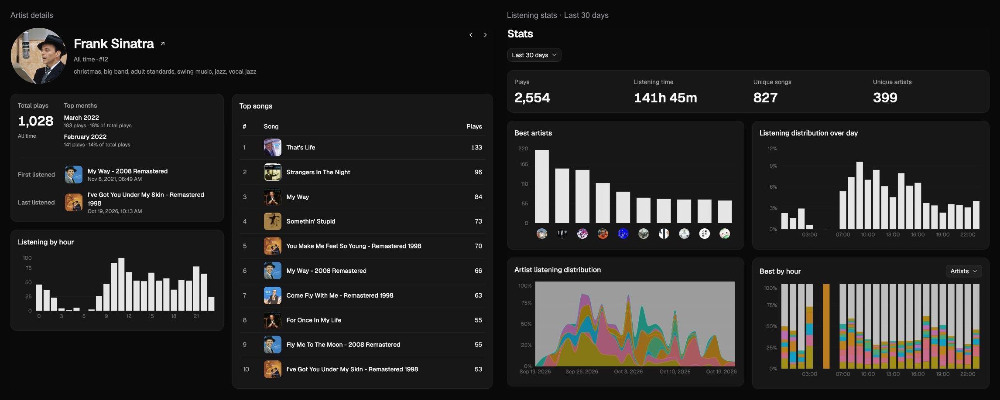

# Spotistat client

Astro and React frontend for [Spotistat](https://spotify.lth.so).

[Product overview](../../README.md) · [Screenshots](../../README.md#screenshots) · [Server setup](../../README.md#run-locally)

<p align="center">
  <a href="../../docs/screenshots/overview.png">
    
  </a>
</p>

## Getting started

You need Node.js 22.22 or later and a running Spotistat API. Run these commands from `apps/client`:

```sh
pnpm install --frozen-lockfile
```

Create `.env` in this directory:

```dotenv
PUBLIC_API_BASE_URL=/api
```

```sh
pnpm exec astro dev --background
```

Open `http://127.0.0.1:4321`. The client proxies `/api` to `http://127.0.0.1:8080`. Change the proxy target in `astro.config.mjs` if your API runs elsewhere.

```sh
pnpm exec astro dev status
pnpm exec astro dev logs
pnpm exec astro dev stop
```

## Development

UI components come from shadcn/ui. Server state uses TanStack Query; HTTP requests use Axios.

Astro handles routing and page composition. React handles interactive UI. Imports follow the FSD layer order defined in [AGENTS.md](AGENTS.md).

```text
src/
├── pages/      # Routes and page composition
├── layouts/    # Astro document layouts
├── app/        # Providers, app shell, and global styles
├── widgets/    # Page sections
├── features/   # User actions
├── entities/   # Domain models and APIs
└── shared/     # Common UI, HTTP setup, and utilities
```

```sh
pnpm typecheck
pnpm test
pnpm lint
pnpm build
```

`PUBLIC_API_BASE_URL` is set at build time. Set `SITE_URL` to the public URL for production builds.
